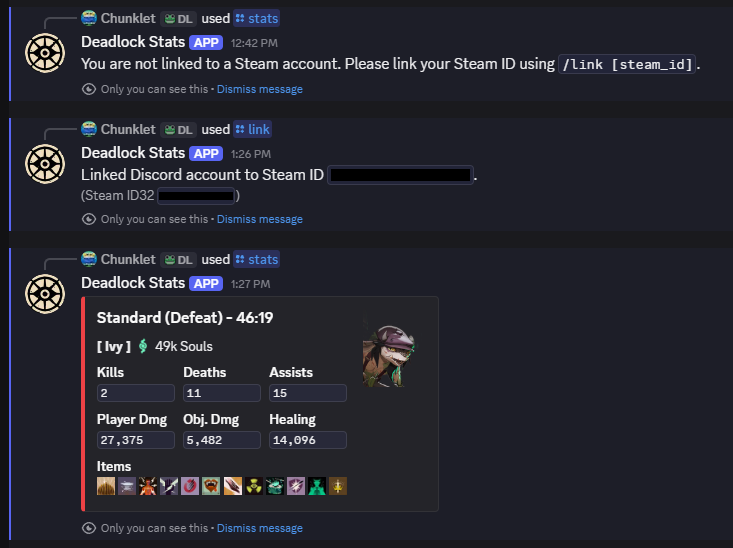

# Deadlock Discord Bot

A Discord bot that, once linked with a Steam ID, displays various Deadlock statistics for a user.

## The Problem

In my free time, I play the game Deadlock. After matches, I sometimes like to review my statistics, but existing solutions can sometimes feel cumbersome to use. With this project, my goal is to create a simpler solution that interfaces with a service I'm already familiar with: Discord.

## How It Works

In order to use any of the stats-related commands, a user needs to first link their Discord account to a Steam ID. After that, each command will reference the Steam account connected to the given ID.

### Stats Command

The "stats" command (shown below) is relatively straightforward in its functionality. After ensuring the user running the command is linked to a Steam ID, an API call is made with it to grab the most recent match's statistics. After fetching the relevant stats and game assets, an embed is assembled and sent back to the user.


## Tech Stack

- **Language:** Python
- **Libraries:** discord.py, aiohttp, python-dotenv
- **External Tools:** api.deadlock-api.com

## Setup

Check that you have Python installed on your device. If you don't, you can find the installer on [python.org](www.python.org).
Next, set up a bot on the Discord Developer Portal and take note of the bot token as you'll need it for setup.

```bash
git clone https://github.com/chunkletier/Deadlock-Discord-Bot
cd Deadlock-Discord-Bot
pip install -r requirements.txt

# Windows
echo 'DISCORD_TOKEN="your_secret_value"' | Out-File -FilePath .env -Encoding utf8

# Mac / Linux
echo 'DISCORD_TOKEN="[Your Token]"' > .env
```

**Note:** For the first time you run the bot, you will need to uncomment the code block at the bottom of the `on_ready()` function in `bot.py`:

```python
try:
    synced = await bot.tree.sync()
    print(f'Synced {len(synced)} command(s)')
except Exception as e:
    print(f'Error syncing commands: {e}')
```

This registers the commands in `bot.py` with the Discord bot. After it has run once, it is highly recommended to comment the code again. If it is repeatedly run unnecessarily, it is possible for the bot to be rate limited by Discord. Only uncomment if you create new slash commands that need to be registered.

## Usage

In order to use the bot, first add it to your Discord server of choice. To start it, run the following terminal command in the bot directory:
```bash
python .\src\bot.py
```
While the script is running, the bot will be online and responsive to commands. When it's not, the bot will be offline and unresponsive.

### Example



[//]: # (## Demo)

[//]: # ()
[//]: # (The demo video is currently unavailable.)

## Roadmap

- [ ] Automated match stats
- [ ] Statistic trends
- [ ] Career statistics
- [ ] Hero statistics
- [ ] Match stats timeline

## Author

Nathan Wachman, https://github.com/chunkletier